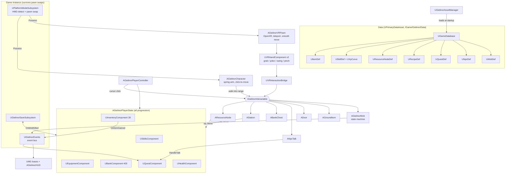

# Architecture

Mirrors the Unity scaffold. **Content is data, systems are components, and input modes are thin adapters over one interaction contract.**

## Key decisions
- **Progression on `APlayerState`.** Swapping pawns between desktop and VR never touches skills, inventory or quests. PlayerState is also where replication goes when multiplayer resumes. A future `GetLifetimeReplicatedProps` plus `UPROPERTY(Replicated)` drop straight in.
- **Event bus instead of hard references.** Quests listen for `OnItemGained` and `OnMobKilled`, and UI listens for xp, messages and dialogue. New systems (achievements, collection log, tutorial) subscribe without touching existing code.
- **One interaction contract.** `IGielinorInteractable` has `Interact`, `StopInteract`, `OnToolHit`, `GetInteractPoint` and `GetInteractRange`. Repeating actions (gathering, make-all crafting) are timers on `AInteractableActor` that stop when the player walks out of range. That works the same for a click-to-move character and a teleporting VR player.
- **Mob AI in code.** It's a ~100-line state machine on a 10 Hz tick using the stock `AAIController` and NavMesh. Move to StateTree when behaviours grow.
- **Data ids, not asset paths, in saves.** Renaming or moving assets won't break saves.
- **Anti-tunnelling.** The character uses `MaxSimulationTimeStep = 0.025` with 8 iterations, and the VR pawn sweeps in ≤10 cm sub-steps. Walls stay solid on hitches, which is the lesson from the web build's Smithy bug.

## Desktop ↔ VR interaction map

| Action | Desktop (mouse/keyboard/gamepad) | VR (controllers / hands) | Shared code path |
|---|---|---|---|
| Move | WASD / left stick, or click ground (NavMesh path) | Left stick smooth move (head-relative, vignette) or teleport arc (right stick forward, release) projected onto the NavMesh | `CharacterMovement` / `AGielinorVRPawn::Tick` |
| Turn / look | Right-drag or right stick orbits the spring arm | Snap 45° (default) or smooth turn on right stick X; head look | – |
| Gather (tree/rock/fish) | Click node → walk → `Interact` → timed loop | Grip or poke the node → `Interact` loop; **or** draw the tool (grip in empty space) and swing it → `OnToolHit(Power)` instant roll with a bonus | `AResourceNode::Roll` |
| Craft (furnace/anvil/range) | Click station → make-all loop | Poke or grip the station → same loop | `AStation::OnLoopTick` |
| Bank | Click chest → `Bank->Open()`; closes when you walk away | Grip or poke the chest; UI on the wrist panel via laser | `UBankComponent` |
| Talk / quests | Click NPC (or E / gamepad A nearby) | Poke or grip the NPC | `UQuestComponent::HandleTalk` |
| Doors | Click → swings away from you | Push or grab the door | `ADoor::Interact` |
| Pick up loot | Click ground item | Grab it | `AGroundItem::Interact` |
| Melee | Click mob → auto-approach → auto-attack every 2.4 s | Draw weapon, swing through the mob; speed sets Power 0.3–1; half-tick cooldown; haptics | `AGielinorMob::ReceivePlayerHit` + `UCombatMath` |
| UI | Screen-space UMG (Canvas fallback) | Same widget class on a wrist `UWidgetComponent`; right-hand `UWidgetInteractionComponent` laser + trigger | `UGielinorWidgetBase` subclasses |
| Mode switch | Launch with `-novr`, or take the headset off | Put the headset on (or `-vr`) | `UPlatformModeSubsystem` |
